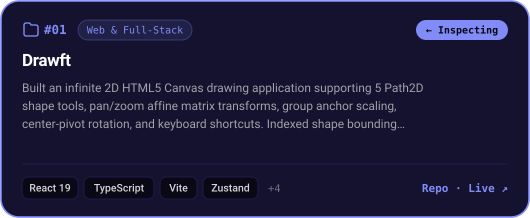
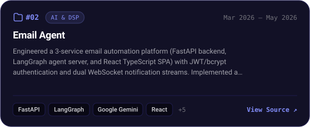
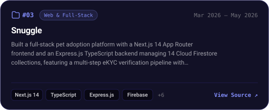
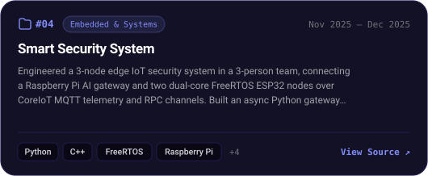

<!-- AUTO-GENERATED FROM ../portfolio/src/lib/data.ts — Run `bun run generate` to sync -->

  

 

<!-- ===================================================================== -->
<!-- 01 / CASE STUDIES — 2x2 SPOTLIGHT GRID + INTERACTIVE INSPECTOR        -->
<!-- ===================================================================== -->

  

<table border="0" cellspacing="0" cellpadding="0" width="100%">
  <tr>
    <td width="50%" valign="top">
      
    </td>
    <td width="50%" valign="top">
      
    </td>
  </tr>
  <tr>
    <td width="50%" valign="top">
      
    </td>
    <td width="50%" valign="top">
      
    </td>
  </tr>
</table>

### 🔎 Interactive Project Inspector — All 12 Engineering Case Studies

Mirrors the split-pane <strong>Project Inspector</strong> on <a href="https://hoangm960.github.io/">hoangm960.github.io</a>. Click any project below to inspect its full architecture and stack:

#### `01 · Web & Full-Stack` (4 Systems)

  
<code>#01</code> <strong>Drawft</strong> &nbsp;—&nbsp; <code>Web &amp; Full-Stack</code> · Jun 2025 — Present · React 19 · TypeScript · Vite · Zustand · ⚡ <code>Live Demo</code>

   
  <blockquote>
    
<strong>ARCHITECTURE &amp; ENGINEERING SUMMARY</strong> 
    Built an infinite 2D HTML5 Canvas drawing application supporting 5 Path2D shape tools, pan/zoom affine matrix transforms, group anchor scaling, center-pivot rotation, and keyboard shortcuts. Indexed shape bounding boxes in an rbush R-tree synchronized across live mutations and undo/redo snapshots, backed by 5 modular Zustand stores and validated across 17 Jest suites and 6 Playwright visual regression specs.

    
<strong>TECHNOLOGY STACK (8)</strong> 
    <code>React 19</code> <code>TypeScript</code> <code>Vite</code> <code>Zustand</code> <code>Tailwind CSS</code> <code>rbush</code> <code>Jest</code> <code>Playwright</code>

    
<a href="https://github.com/hoangm960/drawft"><strong>View Source (hoangm960/drawft) ↗</strong></a> &nbsp;·&nbsp; <a href="https://hoangm960.github.io/drawft/"><strong>Launch Live Demo ↗</strong></a>

  </blockquote>

  
<code>#03</code> <strong>Snuggle</strong> &nbsp;—&nbsp; <code>Web &amp; Full-Stack</code> · Mar 2026 — May 2026 · Next.js 14 · TypeScript · Express.js · Firebase

   
  <blockquote>
    
<strong>ARCHITECTURE &amp; ENGINEERING SUMMARY</strong> 
    Built a full-stack pet adoption platform with a Next.js 14 App Router frontend and an Express.js TypeScript backend managing 14 Cloud Firestore collections, featuring a multi-step eKYC verification pipeline with 6-digit OTP email validation and RBAC admin review. Engineered Socket.io real-time chat and a PDFKit digital adoption contract service with dual-party e-signatures, verified across 24 Jest + Supertest and 14 Vitest test suites.

    
<strong>TECHNOLOGY STACK (10)</strong> 
    <code>Next.js 14</code> <code>TypeScript</code> <code>Express.js</code> <code>Firebase</code> <code>Socket.io</code> <code>Tailwind CSS</code> <code>Zod</code> <code>PDFKit</code> <code>Jest</code> <code>Vitest</code>

    
<a href="https://github.com/hoangm960/snuggle"><strong>View Source (hoangm960/snuggle) ↗</strong></a>

  </blockquote>

  
<code>#09</code> <strong>Trivia Scoring</strong> &nbsp;—&nbsp; <code>Web &amp; Full-Stack</code> · Feb 2024 — Apr 2025 · React · JavaScript · Socket.io · Express.js · ⚡ <code>Live Demo</code>

   
  <blockquote>
    
<strong>ARCHITECTURE &amp; ENGINEERING SUMMARY</strong> 
    Built a real-time multiplayer trivia and credit-wagering web platform used in live STEM Club events with 20+ concurrent participants, reducing manual score tallying time from ~10 minutes to under 30 seconds per round. Synchronized 4-stage game state transitions across 6 route views, countdown timers, and live projector scoreboards using Socket.io, Express.js REST APIs, and Firebase CI/CD.

    
<strong>TECHNOLOGY STACK (6)</strong> 
    <code>React</code> <code>JavaScript</code> <code>Socket.io</code> <code>Express.js</code> <code>Firebase</code> <code>GitHub Actions</code>

    
<a href="https://github.com/hoangm960/trivia_scoring"><strong>View Source (hoangm960/trivia_scoring) ↗</strong></a> &nbsp;·&nbsp; <a href="https://trivia-scoring.web.app"><strong>Launch Live Demo ↗</strong></a>

  </blockquote>

  
<code>#12</code> <strong>Astrea</strong> &nbsp;—&nbsp; <code>Web &amp; Full-Stack</code> · Sep 2020 — Dec 2021 · Python · PyQt5 · MySQL · Cryptography

   
  <blockquote>
    
<strong>ARCHITECTURE &amp; ENGINEERING SUMMARY</strong> 
    Led a 3-member team to build a desktop programming education and automated code-grading platform in Python and PyQt5, winning 3rd Prize at the Hue Science and Engineering Fair. Engineered an automated judging engine using subprocess pipes to compile and evaluate student Python and Free Pascal submissions with 2-second execution timeouts, stdout diffing, and encrypted MySQL virtual classrooms.

    
<strong>TECHNOLOGY STACK (4)</strong> 
    <code>Python</code> <code>PyQt5</code> <code>MySQL</code> <code>Cryptography</code>

    
<a href="https://github.com/hoangm960/Astraea"><strong>View Source (hoangm960/Astraea) ↗</strong></a>

  </blockquote>

#### `02 · AI & DSP` (3 Systems)

  
<code>#02</code> <strong>Email Agent</strong> &nbsp;—&nbsp; <code>AI &amp; DSP</code> · Mar 2026 — May 2026 · FastAPI · LangGraph · Google Gemini · React

   
  <blockquote>
    
<strong>ARCHITECTURE &amp; ENGINEERING SUMMARY</strong> 
    Engineered a 3-service email automation platform (FastAPI backend, LangGraph agent server, and React TypeScript SPA) with JWT/bcrypt authentication and dual WebSocket notification streams. Implemented a stateful LangGraph workflow with human-in-the-loop interrupt approval, 18 Google Gemini ReAct tools for email drafting, calendar conflict checks, and PDF parsing, plus a local SentenceTransformers + FAISS RAG pipeline verified by 11 Pytest modules.

    
<strong>TECHNOLOGY STACK (9)</strong> 
    <code>FastAPI</code> <code>LangGraph</code> <code>Google Gemini</code> <code>React</code> <code>TypeScript</code> <code>SQLite</code> <code>FAISS</code> <code>WebSockets</code> <code>Pytest</code>

    
<a href="https://github.com/zk-qmy/email-agent"><strong>View Source (zk-qmy/email-agent) ↗</strong></a>

  </blockquote>

  
<code>#07</code> <strong>EQ Hand</strong> &nbsp;—&nbsp; <code>AI &amp; DSP</code> · Apr 2025 — May 2025 · Python · OpenCV · MediaPipe · SciPy

   
  <blockquote>
    
<strong>ARCHITECTURE &amp; ENGINEERING SUMMARY</strong> 
    Led a 3-developer team to build a real-time, gesture-controlled 3-band audio equalizer desktop app in Python using PyQt6, threaded 44.1 kHz sounddevice streaming, and OpenCV + MediaPipe dual-hand tracking. Engineered a real-time DSP audio pipeline with 2nd-order SciPy Butterworth filters, a dynamic peak limiter, and a state-machine gesture controller with 3-step palm-scale calibration.

    
<strong>TECHNOLOGY STACK (9)</strong> 
    <code>Python</code> <code>OpenCV</code> <code>MediaPipe</code> <code>SciPy</code> <code>NumPy</code> <code>PyQt6</code> <code>sounddevice</code> <code>pydub</code> <code>FFmpeg</code>

    
<a href="https://github.com/hoangminh2901/eq-hand"><strong>View Source (hoangminh2901/eq-hand) ↗</strong></a>

  </blockquote>

  
<code>#08</code> <strong>Unmixer</strong> &nbsp;—&nbsp; <code>AI &amp; DSP</code> · Mar 2025 — Apr 2025 · React 19 · TypeScript · Vite · Tailwind CSS · ⚡ <code>Live Demo</code>

   
  <blockquote>
    
<strong>ARCHITECTURE &amp; ENGINEERING SUMMARY</strong> 
    Built a full-stack color unmixing web application that decomposes target hex colors into exact watercolor pigment mixing ratios. Engineered a Python and Flask REST API using NumPy and SciPy SLSQP constrained optimization to minimize CIE76 Delta-E perceptual distance in D65 CIELAB space across subtractive CMY mixtures, paired with an interactive React 19 and Tailwind CSS client.

    
<strong>TECHNOLOGY STACK (8)</strong> 
    <code>React 19</code> <code>TypeScript</code> <code>Vite</code> <code>Tailwind CSS</code> <code>Python</code> <code>Flask</code> <code>NumPy</code> <code>SciPy</code>

    
<a href="https://github.com/hoangm960/unmixer"><strong>View Source (hoangm960/unmixer) ↗</strong></a> &nbsp;·&nbsp; <a href="https://unmixer.onrender.com"><strong>Launch Live Demo ↗</strong></a>

  </blockquote>

#### `03 · Embedded & Systems` (5 Systems)

  
<code>#04</code> <strong>Smart Security System</strong> &nbsp;—&nbsp; <code>Embedded &amp; Systems</code> · Nov 2025 — Dec 2025 · Python · C++ · FreeRTOS · Raspberry Pi

   
  <blockquote>
    
<strong>ARCHITECTURE &amp; ENGINEERING SUMMARY</strong> 
    Engineered a 3-node edge IoT security system in a 3-person team, connecting a Raspberry Pi AI gateway and two dual-core FreeRTOS ESP32 nodes over CoreIoT MQTT telemetry and RPC channels. Built an async Python gateway running OpenCV YuNet/SFace face recognition with 3-frame debounced intruder alerts and an aiohttp dashboard, alongside multi-tasking ESP32 C++ firmware running on-device TensorFlow Lite Micro anomaly detection.

    
<strong>TECHNOLOGY STACK (8)</strong> 
    <code>Python</code> <code>C++</code> <code>FreeRTOS</code> <code>Raspberry Pi</code> <code>ESP32</code> <code>OpenCV</code> <code>TensorFlow Lite Micro</code> <code>MQTT</code>

    
<a href="https://github.com/hoangminh2901/final-embeded"><strong>View Source (hoangminh2901/final-embeded) ↗</strong></a>

  </blockquote>

  
<code>#05</code> <strong>Fire Detection &amp; Extinguishment System</strong> &nbsp;—&nbsp; <code>Embedded &amp; Systems</code> · Oct 2025 — Nov 2025 · C++ · FreeRTOS · ESP32 · TensorFlow Lite Micro

   
  <blockquote>
    
<strong>ARCHITECTURE &amp; ENGINEERING SUMMARY</strong> 
    Architected a 6-task ESP32 hazard monitoring and suppression system in C++ using FreeRTOS tasks pinned across cores for concurrent DHT20/ultrasonic sensing, I2C LCD updates, and actuator control. Synchronized inter-task communication with FreeRTOS mutexes, binary semaphores, and overwrite queues, deploying an on-device 8 KB TensorFlow Lite Micro 3-class hazard model alongside a LittleFS Wi-Fi SoftAP web server.

    
<strong>TECHNOLOGY STACK (6)</strong> 
    <code>C++</code> <code>FreeRTOS</code> <code>ESP32</code> <code>TensorFlow Lite Micro</code> <code>PlatformIO</code> <code>LittleFS</code>

    
<a href="https://github.com/hoangminh2901/midterm-embeded/tree/RTOS_Project"><strong>View Source (hoangminh2901/midterm-embeded/tree/RTOS_Project) ↗</strong></a>

  </blockquote>

  
<code>#06</code> <strong>Onion</strong> &nbsp;—&nbsp; <code>Embedded &amp; Systems</code> · Apr 2025 — May 2025 · Python · ANTLR4 · PyInstaller · GitHub Actions

   
  <blockquote>
    
<strong>ARCHITECTURE &amp; ENGINEERING SUMMARY</strong> 
    Designed and built an interpreted Lisp- and Python-inspired S-expression programming language from scratch using an ANTLR4 grammar and a modular parse-tree visitor hierarchy in Python. Implemented lexical scoping, environment-capturing lambda closures, functional list primitives, optional static type checking, and an interactive REPL and CLI runner with AST export and 41 automated test programs.

    
<strong>TECHNOLOGY STACK (4)</strong> 
    <code>Python</code> <code>ANTLR4</code> <code>PyInstaller</code> <code>GitHub Actions</code>

    
<a href="https://github.com/hoangminh2901/onion-lang"><strong>View Source (hoangminh2901/onion-lang) ↗</strong></a>

  </blockquote>

  
<code>#10</code> <strong>Terminal Emulator</strong> &nbsp;—&nbsp; <code>Embedded &amp; Systems</code> · Nov 2024 — Dec 2024 · C · Linux · POSIX System Calls · Make

   
  <blockquote>
    
<strong>ARCHITECTURE &amp; ENGINEERING SUMMARY</strong> 
    Built a UNIX command-line shell in C supporting interactive read-parse-execute loops, 4 built-in commands (cd, ls, help, exit), and external process execution via fork, execvp, and waitpid. Implemented multi-stage command pipelining (|) using POSIX pipe and dup2 file-descriptor redirection alongside concurrent background job execution (&amp;) and child signal termination diagnostics.

    
<strong>TECHNOLOGY STACK (4)</strong> 
    <code>C</code> <code>Linux</code> <code>POSIX System Calls</code> <code>Make</code>

    
<a href="https://github.com/hoangminh2901/terminal-emulator"><strong>View Source (hoangminh2901/terminal-emulator) ↗</strong></a>

  </blockquote>

  
<code>#11</code> <strong>S.E.A</strong> &nbsp;—&nbsp; <code>Embedded &amp; Systems</code> · Nov 2021 — Mar 2022 · Flutter · Dart · Python · C++ (Arduino)

   
  <blockquote>
    
<strong>ARCHITECTURE &amp; ENGINEERING SUMMARY</strong> 
    Built a cross-platform Flutter monitoring application and IoT telemetry pipeline for ocean renewable energy stations, winning 2nd Prize at the Hue Science and Engineering Fair. Engineered a 3-process Python hardware bridge interfacing with an Arduino controller at 9600 baud to stream 8 DC/AC power metrics, GPS coordinates, and fingerprint auth states to a remote MySQL database.

    
<strong>TECHNOLOGY STACK (5)</strong> 
    <code>Flutter</code> <code>Dart</code> <code>Python</code> <code>C++ (Arduino)</code> <code>MySQL</code>

    
<a href="https://github.com/hoangm960/Station_energy_automatic"><strong>View Source (hoangm960/Station_energy_automatic) ↗</strong></a>

  </blockquote>

 

<!-- ===================================================================== -->
<!-- 02 / CAPABILITIES — TECHNICAL STACK BY LAYER                          -->
<!-- ===================================================================== -->

  

 

<!-- ===================================================================== -->
<!-- 03 / DISPATCH — CONTACT & LINKS                                       -->
<!-- ===================================================================== -->

  

  
  &nbsp;
  
  &nbsp;
  
  &nbsp;
  

  Designed &amp; Built by <strong><a href="https://hoangm960.github.io/">Hoang Nhat Minh</a></strong> · 2026

